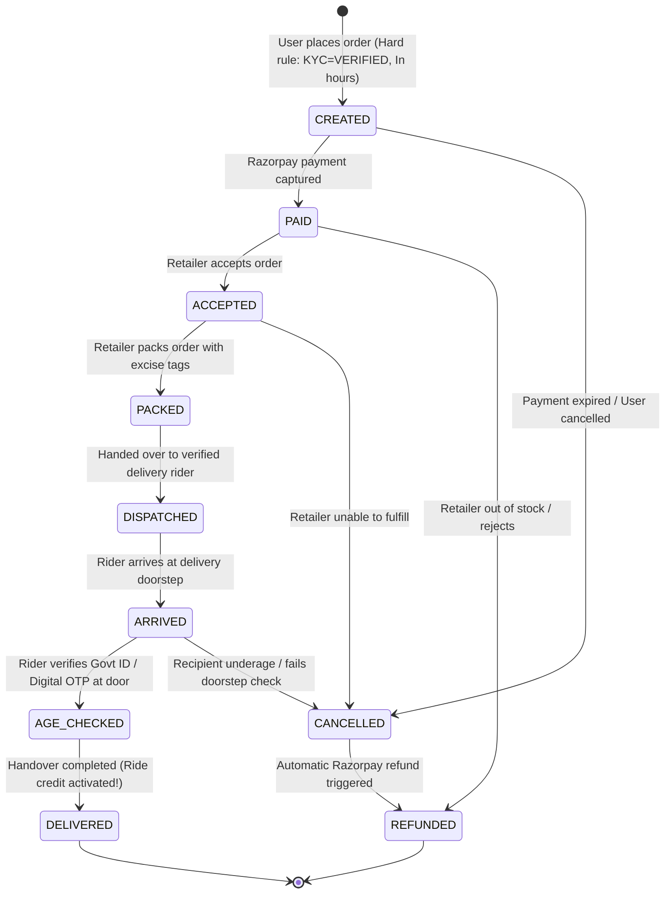
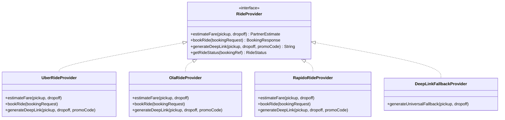

# BOOZER · Technical Architecture & System Design
**Version:** 1.0 (MVP)  
**Target:** 12-Week Pilot Launch  
**Compliance Baseline:** Indian State Excise Regulations & Digital Personal Data Protection (DPDP) Act 2023

---

## 1. System Overview & Architectural Principles

BOOZER is built as a **Modular Monolith** designed around two unified missions:
1. **Legal Alcohol Delivery:** Facilitate order placement and doorstep delivery solely through licensed retailers at statutory Maximum Retail Prices (MRP) with dual-step age checks (at onboarding and at the door).
2. **Safe Ride Home:** Provide an immediate, friction-free safe ride home via ride credits and deep integrations (Uber/Ola/Rapido/Fleets), accompanied by a persistent SOS and trip-sharing emergency system.

```mermaid
graph TD
    subgraph Client Apps
        CustomerApp["📱 Customer Mobile App<br/>(React Native / Expo)"]
        RetailerWeb["💻 Retailer Portal<br/>(React / Vite)"]
        AdminWeb["🛡️ Admin Dashboard<br/>(React / Vite)"]
    end

    subgraph API Gateway & Monolith Boundary
        API["Spring Boot Modular Monolith (Java 21)"]
    end

    subgraph Core Internal Modules
        AuthMod["auth"]
        KycMod["kyc"]
        CatalogMod["catalog"]
        OrderMod["orders"]
        PayMod["payments"]
        DeliveryMod["delivery"]
        RideMod["rides"]
        SafetyMod["safety"]
        AdminMod["admin"]
        NotifyMod["notifications"]
        AuditMod["audit"]
    end

    subgraph Data & Cache Layer
        Postgres[(PostgreSQL 16<br/>Orders, Users, Ledger)]
        Redis[(Redis 7<br/>OTP Limits, Session Blacklist, GPS Stream)]
    end

    subgraph External Partner Integrations
        DigiLocker["DigiLocker / KYC API<br/>(Age & ID Verification)"]
        Razorpay["Razorpay Gateway<br/>(Payments & Refunds)"]
        MapsAPI["Google Maps Platform<br/>(Geocoding & Tracking)"]
        RidePartners["Ride Partners<br/>(Uber / Ola / Rapido API & Deep Links)"]
        Messaging["FCM + SMS Gateway<br/>(Twilio / Gupshup)"]
    end

    CustomerApp -->|HTTPS / WSS| API
    RetailerWeb -->|HTTPS| API
    AdminWeb -->|HTTPS| API

    API --> AuthMod
    API --> KycMod
    API --> CatalogMod
    API --> OrderMod
    API --> PayMod
    API --> DeliveryMod
    API --> RideMod
    API --> SafetyMod
    API --> AdminMod
    API --> NotifyMod
    API --> AuditMod

    OrderMod --> Postgres
    PayMod --> Postgres
    DeliveryMod --> Redis
    AuthMod --> Redis

    KycMod --> DigiLocker
    PayMod --> Razorpay
    DeliveryMod --> MapsAPI
    RideMod --> RidePartners
    NotifyMod --> Messaging
```



---

## 2. Monorepo Structure

```text
/boozer
  ├── /backend                  # Spring Boot 3.3 (Java 21, Maven) Modular Monolith
  │     ├── /src/main/java/com/boozer
  │     │     ├── /auth         # OTP, JWT, Role-based auth
  │     │     ├── /kyc          # DigiLocker verification & DPDP data minimization
  │     │     ├── /catalog      # Licensed retailers, legal MRP stock, search
  │     │     ├── /orders       # Order state machine, cart, compliance checks
  │     │     ├── /payments     # Razorpay order creation, webhooks, refunds
  │     │     ├── /delivery     # Rider assignment, live GPS stream, door verification
  │     │     ├── /rides        # Safe ride credits & RideProvider strategy
  │     │     ├── /safety       # SOS button, emergency contacts, location broadcasting
  │     │     ├── /admin        # KYC review queue, retailer licensing, audit inspection
  │     │     ├── /notifications# Push (FCM), SMS, WhatsApp alerts
  │     │     └── /audit        # Immutable audit logging engine
  │     └── /src/main/resources/db/migration # Flyway migrations
  ├── /mobile                   # React Native (Expo, TypeScript) - Customer App
  │     ├── /src/features       # Feature-driven: auth, kyc, catalog, cart, tracking, rides, safety
  │     └── /src/components     # Persistent SOS component, Design System tokens
  ├── /web                      # React (TypeScript, Vite) - Retailer & Admin Portals
  │     ├── /src/retailer       # Retailer order queue, stock toggles, payout ledger
  │     └── /src/admin          # Flagged KYC review, retailer suspension, refunds, audit log
  ├── /infra                    # Docker Compose & Terraform scripts for AWS Mumbai
  └── /docs                     # Architecture specs, OpenAPI YAML, and runbooks
```

---

## 3. Order State Machine

The order lifecycle is strictly enforced in code via `OrderStateMachine.java`. Every state transition triggers an immutable entry in the `audit_log`.



### Non-Negotiable Hard Rules Enforced in Code
1. **KYC Gatekeeper:** Orders cannot be instantiated unless `users.kyc_status == 'VERIFIED'`.
2. **Statutory Legal MRP:** Alcohol products can only be sold at the fixed statutory price (`product.price_legal_mrp`). No surge pricing, algorithmic discounting, or coupon codes are permitted on alcohol items.
3. **Doorstep Age Gate:** Transition from `ARRIVED` to `DELIVERED` is physically blocked until `age_check_at_door_verified == true`.
4. **Excise Hours & Boundary Enforcement:** Cart validation verifies that the current timestamp is within the retailer's `operating_hours_start` and `operating_hours_end`, and that the destination coordinates fall within the retailer's authorized delivery radius.

---

## 4. RideProvider Strategy Pattern

To mitigate integration friction with ride-sharing companies (Uber, Ola, Rapido), the `rides` module abstracts all partner operations behind a `RideProvider` interface:



If partner API access is delayed during the pilot, the system transparently falls back to pre-populated mobile deep links (`uber://`, `ola://`) with ride credit reimbursement vouchers.

---

## 5. DPDP Act 2023 Compliance & Data Minimization

- **No Raw Identity Documents:** Boozer does not store raw Aadhaar PDF cards, unmasked ID numbers, or biometric credentials.
- **Verification Hash & Reference Only:** The database only stores `provider_ref`, `masked_id_number` (e.g., `XXXX-XXXX-9124`), `calculated_age`, and `age_verified = true`.
- **Granular Consent:** Explicit user consent is logged at onboarding for age verification, emergency contact notification, and live geolocation tracking.
- **Data Retention & Right to Erasure:** Inactive accounts are wiped after statutory excise audit record-keeping windows expire.

---

## 6. Real-Time Rider Location & SOS Pipeline

- **Live Rider Feed:** Riders stream GPS coordinates over WebSockets or HTTP PUT into Redis Geo sets (`GEOADD riders:active <lng> <lat> <order_id>`).
- **Persistent SOS Architecture:** The mobile app renders a persistent SOS floating trigger on all tracking and active ride screens. Pressing and holding for 3 seconds triggers an immediate SMS and push notification to the user's `user_trusted_contacts` with live Google Maps coordinates.
